# Agentic Personas Storefront — Debugging Assessment

> ## Debugging report: an AI agent fleet fixed all 16 seeded bugs in one live interview
> **[Open the master deliverable](https://lifehackinnovations.com/lhi-workspace/api/workspace/share/bHHdRecF/eci-round-two-live/index.html)** ·
> [Bug report (simple and detail)](https://lifehackinnovations.com/lhi-workspace/api/workspace/share/bHHdRecF/eci-round-two-live-bug-report/index.html) ·
> [UI walkthrough, 18 steps, Next/Back](https://lifehackinnovations.com/lhi-workspace/api/workspace/share/bHHdRecF/eci-round-two-live-walkthrough/index.html) ·
> [Live tour: Next drives the real buggy app and the fixed app side by side](https://lifehackinnovations.com/lhi-workspace/api/workspace/share/bHHdRecF/eci-round-two-live-tour/index.html) ·
> [Hosted app](https://lifehackinnovations.com/lhi-workspace/api/workspace/share/bHHdRecF/eci-storefront-app/app/index.html) ·
> [Staffing tree](https://lifehackinnovations.com/lhi-workspace/api/workspace/share/bHHdRecF/eci-round-two-live-tree/index.html)
>
> Static copies of every page are in [`interview-deliverables/`](interview-deliverables/) and open without any login. The hosted links are public and open without a login (served from the author's DigitalOcean infrastructure; the share link expires 11/11/2026, after which use the snapshot). Session links inside the pages point at internal tooling and ask for authentication, so they will not open for other viewers. The hosted app is a shared demo with an in-memory database: anyone can register and add to a cart, and it resets when the service restarts.

## At a glance

| | |
|---|---|
| Bugs found and fixed | **16** (17 commits; the compile trap needed a fix in two packages) |
| Where | `packages/shared` 1, `apps/api` 6, `apps/web` 9 |
| Result | `pnpm build`, typecheck and lint pass; a headless browser walked register, browse, filter, favorite, cart, checkout and logout with zero console errors |
| Tests | None existed in the repo, so no bug has a failing-then-passing automated test. Each bug records its real evidence (build error, API call, or browser run) in the bug report. |
| Detail | [`FINDINGS.md`](FINDINGS.md) lists all 16 with root cause, fix and commit |

```text
Baseline build   ██████████ 100%   Fix API + shared  ██████████ 100%   Fix web          ██████████ 100%
UI smoke test    ██████████ 100%   Hosted app        ██████████ 100%   Bug report       ██████████ 100%
```

## What was fixed

| ID | Commit | Symptom | Fix |
|---|---|---|---|
| API-0 | [`1aee572`](https://github.com/patrickmwatson/interview-built-by-a-clanker/commit/1aee572) | Build failed at `@acme/shared` (stray `@types` picked up by tsc); same trap in the API (`0a99f2e`) | Pin `compilerOptions.types` |
| API-1 | [`477e285`](https://github.com/patrickmwatson/interview-built-by-a-clanker/commit/477e285) | Price filter returned items at or below the minimum | `<=` became `>=` |
| API-2 | [`a2de6be`](https://github.com/patrickmwatson/interview-built-by-a-clanker/commit/a2de6be) | Login response omitted `user.username` | Include it, matching the shared schema |
| API-3 | [`7bd9759`](https://github.com/patrickmwatson/interview-built-by-a-clanker/commit/7bd9759) | CORS blocked `DELETE` from the browser | Allow `DELETE` |
| API-4 | [`9194553`](https://github.com/patrickmwatson/interview-built-by-a-clanker/commit/9194553) | Anyone could delete another user's cart item | Ownership check, 404 otherwise |
| API-5 | [`1c26490`](https://github.com/patrickmwatson/interview-built-by-a-clanker/commit/1c26490) | Checkout left the cart full | Clear the cart after the order is saved |
| API-6 | [`5b4bc9b`](https://github.com/patrickmwatson/interview-built-by-a-clanker/commit/5b4bc9b) | Auth was opt-in, so cart and checkout crashed | Enforce unless `ENFORCE_AUTH=false` |
| WEB-1 | [`0fc142d`](https://github.com/patrickmwatson/interview-built-by-a-clanker/commit/0fc142d) | Web typecheck failed (stray `@types`, unexported `SearchParams`) | Pin types, export the interface |
| WEB-2 | [`35175fa`](https://github.com/patrickmwatson/interview-built-by-a-clanker/commit/35175fa) | Prices shown 100x too high | Format `persona.price`, no multiply |
| WEB-3 | [`0c5ce0a`](https://github.com/patrickmwatson/interview-built-by-a-clanker/commit/0c5ce0a) | Search, filter and sort never refetched | Put the query string in the query key |
| WEB-4 | [`28b1ef3`](https://github.com/patrickmwatson/interview-built-by-a-clanker/commit/28b1ef3) | Favorite heart toggle was inverted | Remove the stray `!` |
| WEB-5 | [`10f0d2c`](https://github.com/patrickmwatson/interview-built-by-a-clanker/commit/10f0d2c) | Favorites and persona page shared one cache key, ran signed out | Distinct key, `enabled: !!user` |
| WEB-6 | [`78fdbb0`](https://github.com/patrickmwatson/interview-built-by-a-clanker/commit/78fdbb0) | Logout kept the token and cached data | Clear token and query cache |
| WEB-7 | [`70e0caf`](https://github.com/patrickmwatson/interview-built-by-a-clanker/commit/70e0caf) | Cart badge never updated | Key `["cart","count"]` so invalidation reaches it |
| WEB-8 | [`57e54be`](https://github.com/patrickmwatson/interview-built-by-a-clanker/commit/57e54be) | Cart quantity could reach zero or below | Disable minus at 1 |
| WEB-9 | [`89fc70c`](https://github.com/patrickmwatson/interview-built-by-a-clanker/commit/89fc70c) | Star ratings shared one SVG gradient id | Unique id per star |

Commit trail: [all commits](https://github.com/patrickmwatson/interview-built-by-a-clanker/commits/main). The web commits changed line endings from CRLF to LF, so GitHub shows whole-file diffs for one-line fixes; add `?w=1` to a commit URL to read the real change.

## What it looks like (after the fixes)

<table><tr>
<td align="center">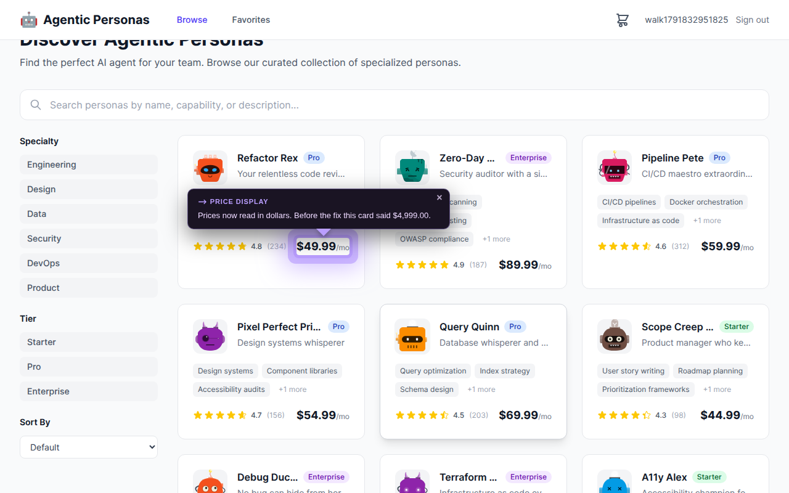<br><sub><b>WEB-2</b> · Prices back to normal</sub></td>
<td align="center">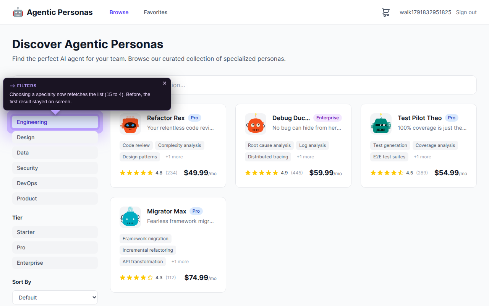<br><sub><b>WEB-3</b> · Filters refetch the list</sub></td>
<td align="center">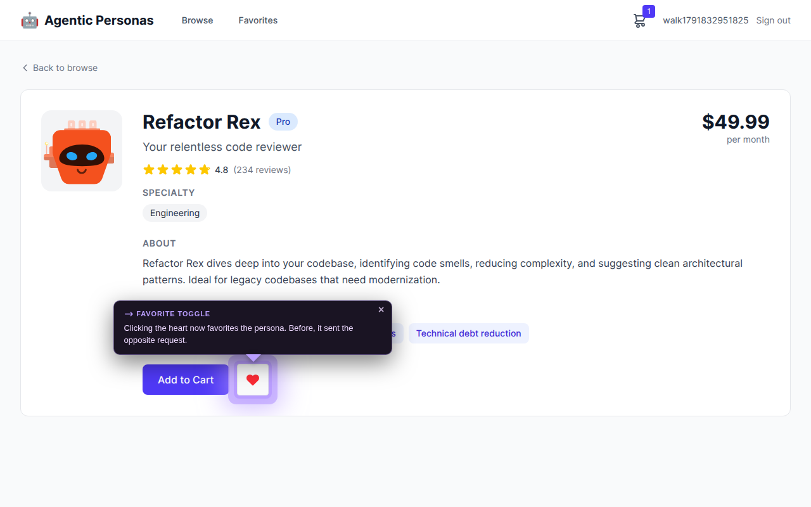<br><sub><b>WEB-4</b> · Favorite heart works the right way round</sub></td></tr><tr>
<td align="center">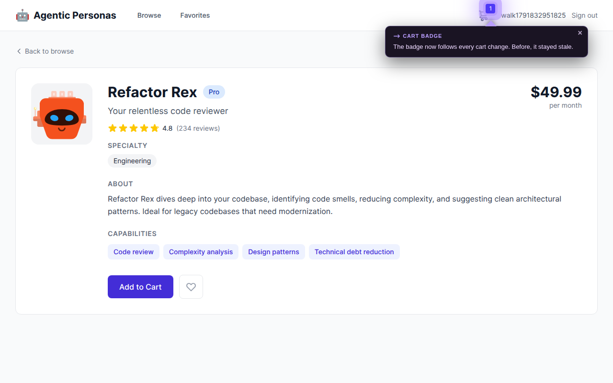<br><sub><b>WEB-7</b> · Cart badge follows the cart</sub></td>
<td align="center">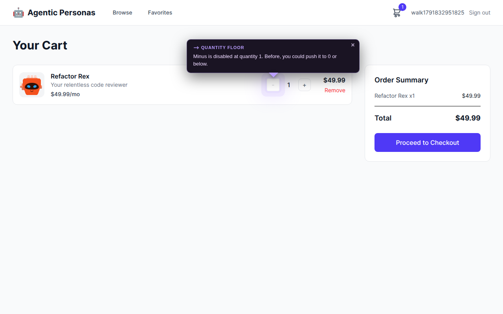<br><sub><b>WEB-8</b> · Minus stops at 1</sub></td>
<td align="center">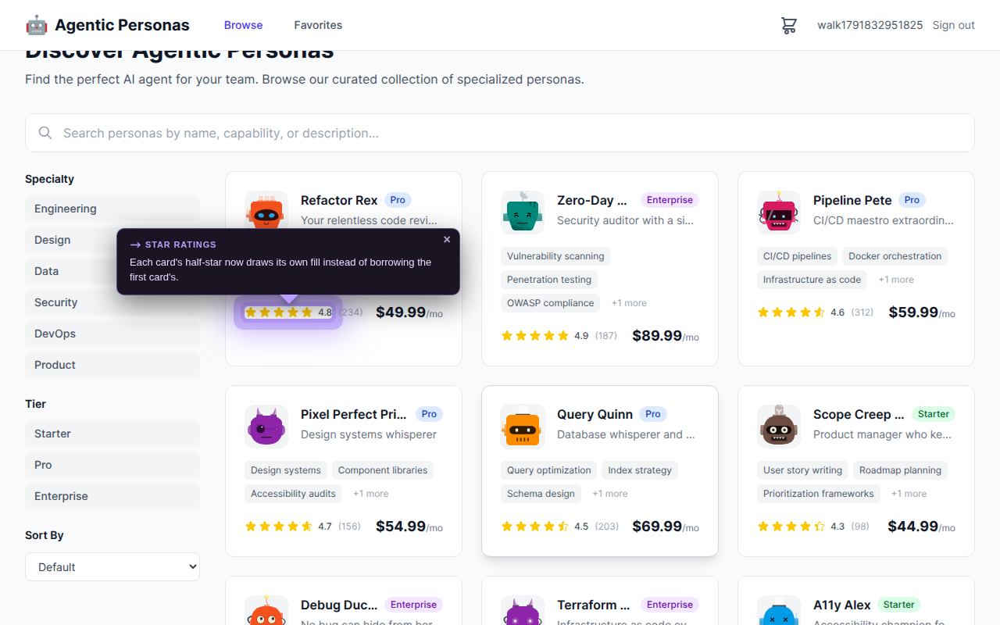<br><sub><b>WEB-9</b> · Star ratings fill correctly</sub></td></tr><tr>
</tr></table>

Six of the 14 screenshots are shown here; all are below and in the [UI walkthrough](interview-deliverables/ui-walkthrough/).

<details>
<summary><b>Show all 14 screenshots</b></summary>

## Every screenshot from the walkthrough

The fixed app with the affected element highlighted. The two build-break bugs (API-0, WEB-1) have no screenshot; the walkthrough shows the real build error instead.

**API-1 · Price filter keeps items at or above the minimum**

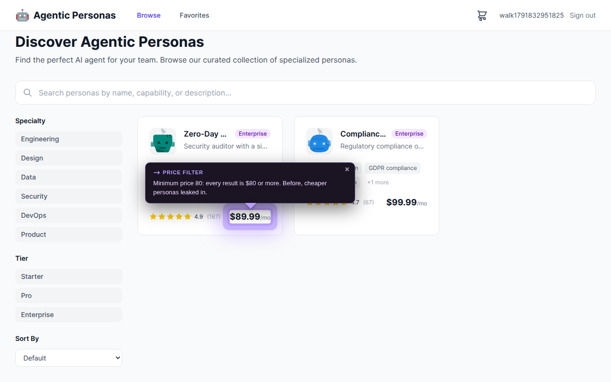

**API-2 · Login returns the username**

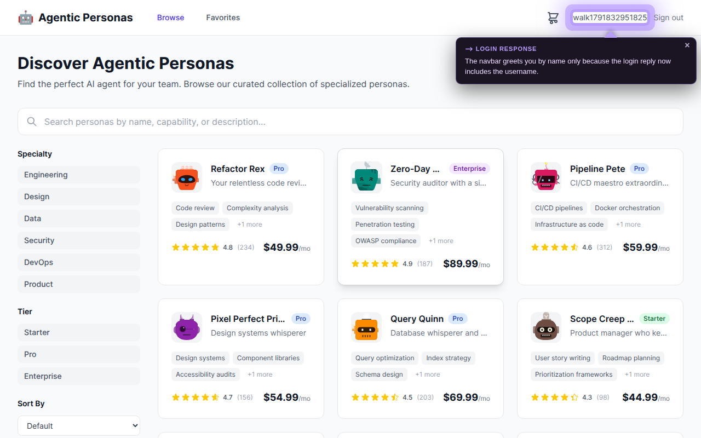

**API-3 · Browser can delete cart and favorite items (CORS)**

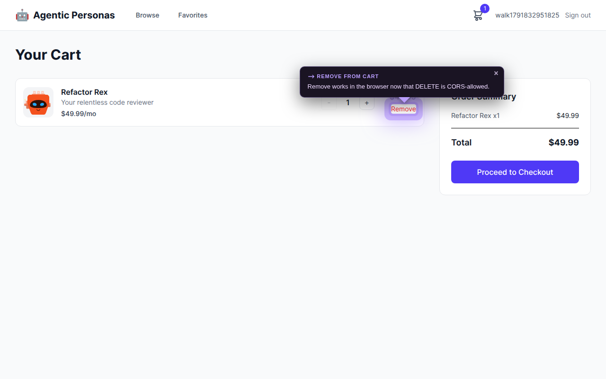

**API-4 · Cart items belong to their owner**

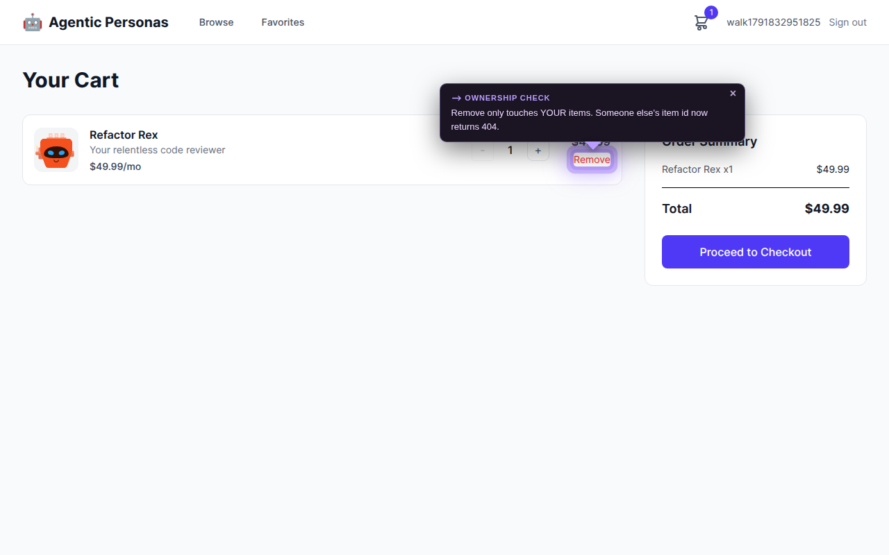

**API-5 · Checkout empties the cart**

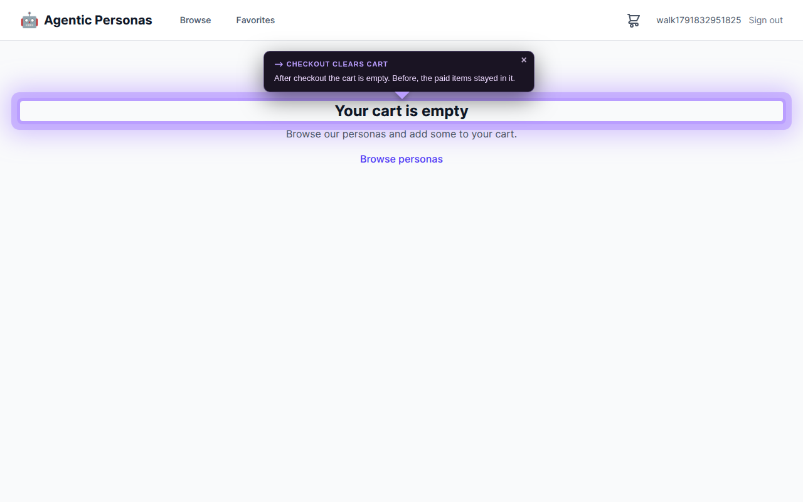

**API-6 · Signed-out requests are rejected, not crashed**

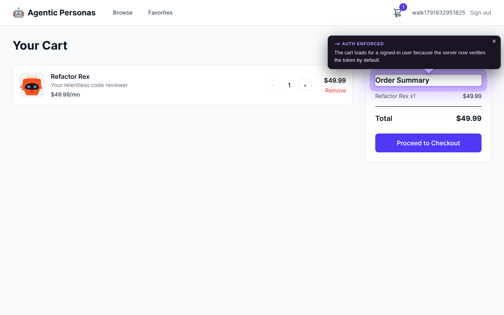

**WEB-2 · Prices back to normal**


**WEB-3 · Filters refetch the list**


**WEB-4 · Favorite heart works the right way round**


**WEB-5 · Favorites do not clash with the persona page**

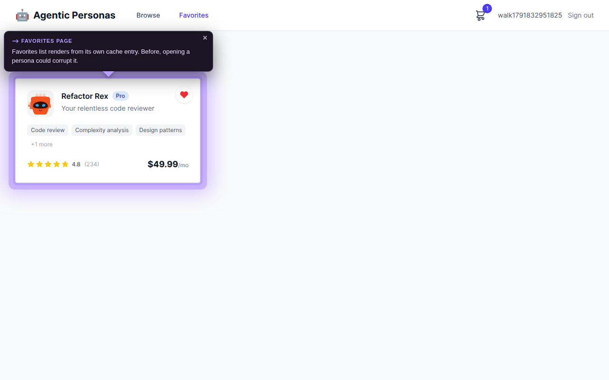

**WEB-6 · Logout really logs out**

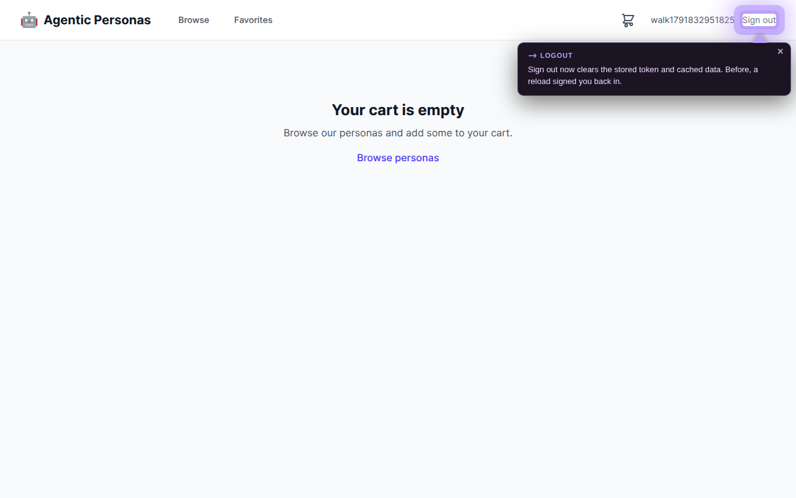

**WEB-7 · Cart badge follows the cart**


**WEB-8 · Minus stops at 1**


**WEB-9 · Star ratings fill correctly**


</details>

## Where the bugs lived

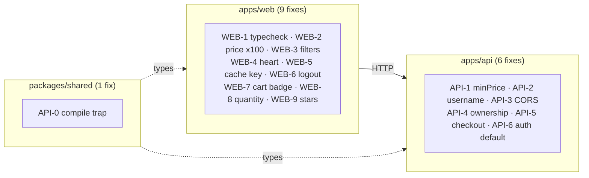

## How the work was done

A lead agent (the overseer) staffed specialist agents (wards) with separate code areas so no two edited the same file. Each ward fixed one bug at a time with a scoped commit, and a health ward watched the build and the fleet.

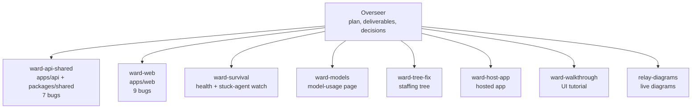

| Principle | What it meant here |
|---|---|
| One writer per area | Separate wards for API/shared and web; cross-area needs went through the overseer |
| Minimal fixes | Every changed line traces to one bug; no drive-by refactors |
| Evidence over claims | Each fix names the command or run that proved it |
| Honest limits | No invented tests; the page says where evidence is a build error, an API call or a browser run |

## Everything the fleet produced

| Deliverable | What it is | Static copy |
|---|---|---|
| Master | Progress bars, plan, decisions, live architecture diagram with narration | [`master-and-live-diagram/`](interview-deliverables/master-and-live-diagram/) |
| Bug report | One section per bug: simple view, then diff, evidence and thinking | [`bug-report/`](interview-deliverables/bug-report/) |
| UI walkthrough | 18-step Next/Back tutorial with spotlighted screenshots | [`ui-walkthrough/`](interview-deliverables/ui-walkthrough/) |
| Staffing tree | Which agent owned which work | [`staffing-tree/`](interview-deliverables/staffing-tree/) |
| Live tour | Next/Back drives the REAL buggy and fixed apps side by side, 18 steps proven anonymously | [`live-tour/`](interview-deliverables/live-tour/) |
| Hosted app build | The fixed storefront as hosted | [`storefront-app-hosted-build/`](interview-deliverables/storefront-app-hosted-build/) |
| Model usage | Claude model counts for the last 30 days | inside the master snapshot, `model-usage/` |

GitHub shows these pages as source. To view them rendered, clone the repo and open each `index.html` in a browser, or use the hosted links above.

---

# The original assessment

Welcome! This is a monorepo storefront application for browsing and purchasing AI-powered "Agentic Personas." The app was recently working, but a series of bugs have been introduced across the stack. Your task is to find and fix them.

## Tech Stack

- **Monorepo**: Turborepo + pnpm workspaces
- **Frontend** (`apps/web`): React 19, TanStack Router, TanStack Query, Tailwind CSS v4
- **Backend** (`apps/api`): Fastify 5, JWT auth, in-memory database
- **Shared** (`packages/shared`): TypeScript types, Zod validation schemas

## Getting Started

```bash
pnpm install
pnpm build
pnpm dev
```

- Frontend: http://localhost:5173
- API: http://localhost:3001

## Your Task

There are bugs scattered throughout the frontend, backend, and shared packages. Some will be immediately obvious (build failures, runtime crashes), while others are more subtle (incorrect behavior, broken features).

Work through the application and fix as many issues as you can. We're evaluating:

- **Debugging approach** — How you identify and isolate problems
- **Code comprehension** — How quickly you orient yourself in an unfamiliar codebase
- **Quality of fixes** — Whether your solutions are correct and clean

Feel free to use any tools or techniques you'd normally use on the job.

## Project Structure

```
apps/
  api/           # Fastify REST API server
  web/           # React SPA
packages/
  shared/        # Shared TypeScript types and Zod schemas
```
